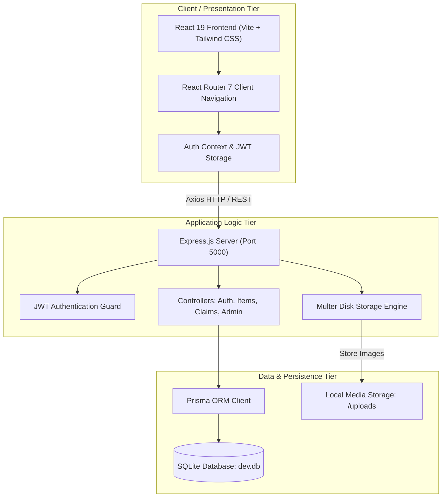
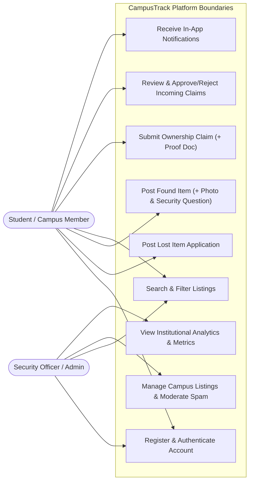
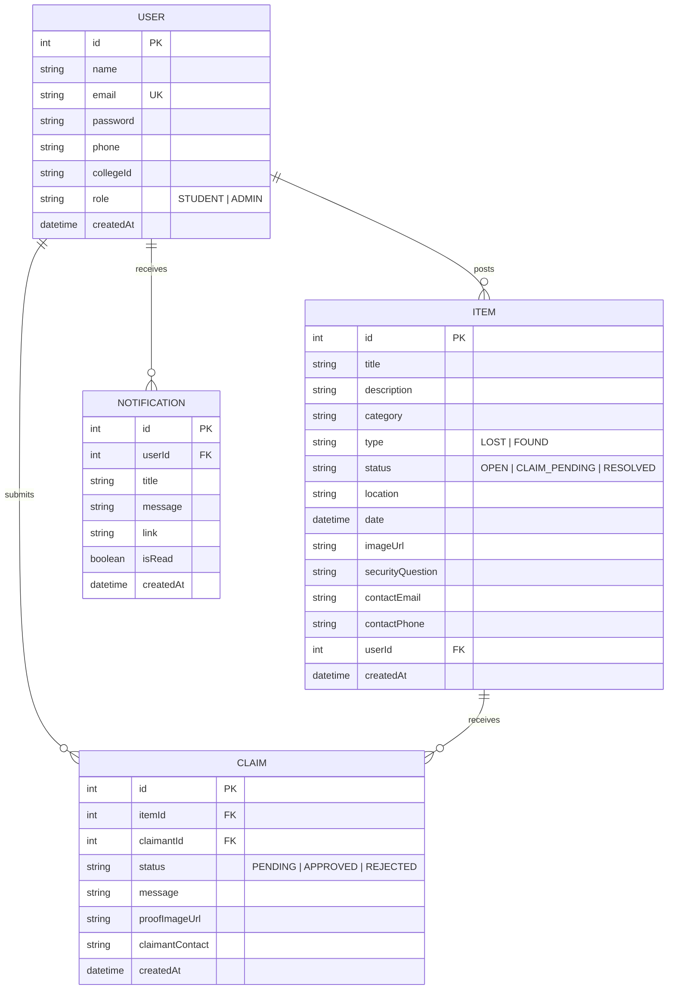
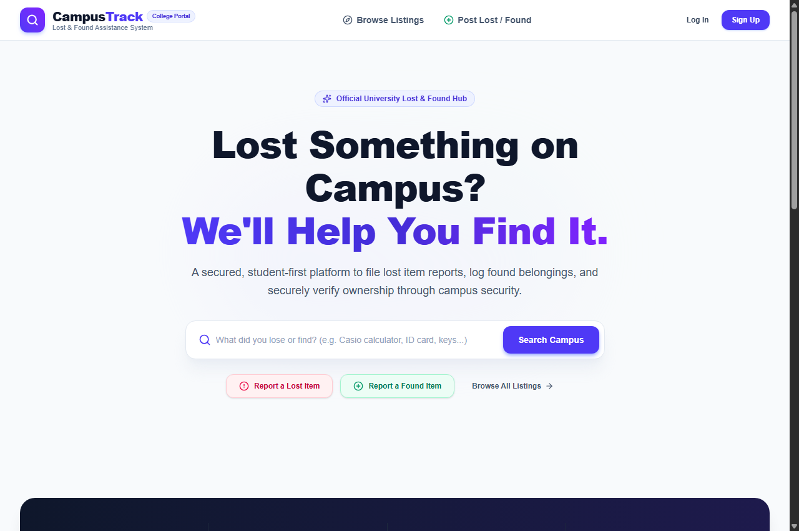
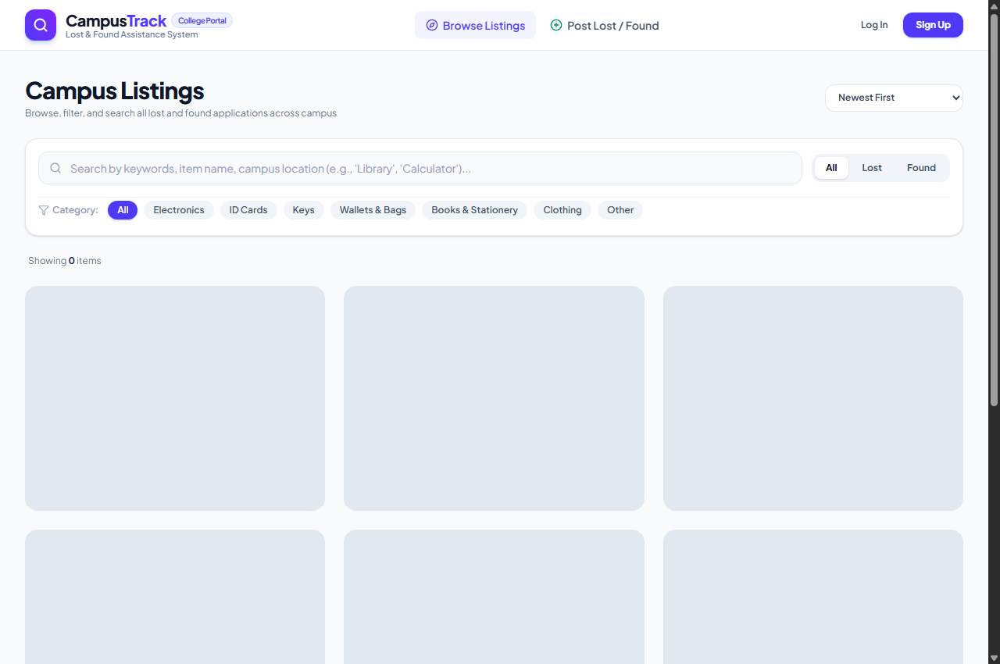
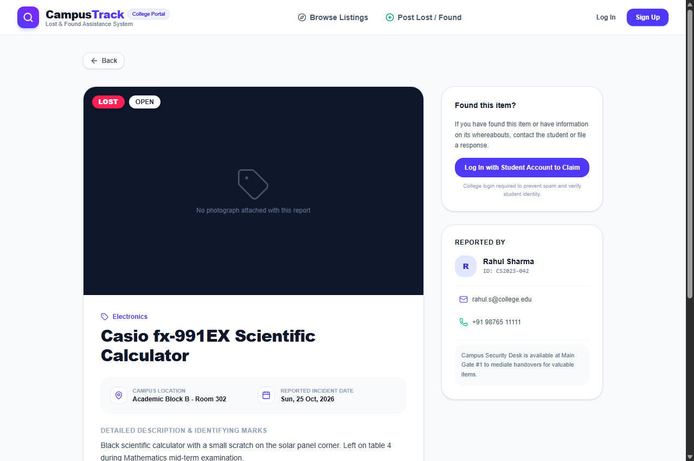
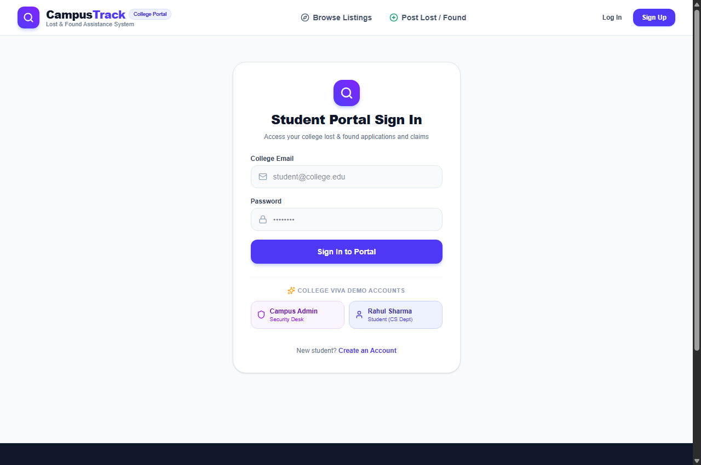
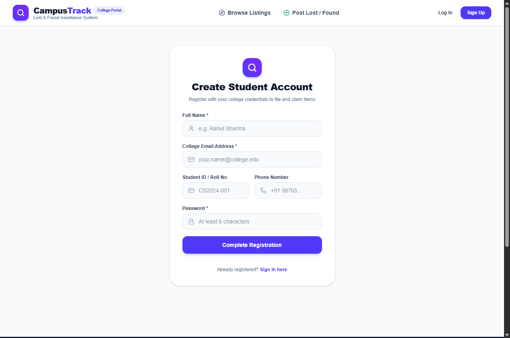

<div style="text-align: center; padding-top: 40px; page-break-after: always;">

# **PROJECT REPORT**

### ON

## **CAMPUSTRACK: A SECURED CENTRALIZED LOST AND FOUND PLATFORM FOR COLLEGE CAMPUSES**

<br/>

*Submitted in partial fulfillment of the requirements for the award of the degree of*  
### **BACHELOR OF TECHNOLOGY / SCIENCE**  
### IN  
### **COMPUTER SCIENCE & ENGINEERING / INFORMATION TECHNOLOGY**

<br/><br/>

**SUBMITTED BY:**  
**Suryakant Jaiswar**  
Seat No : 510512446
Class: T.Y.B.Sc. Computer Science  

<br/>

**UNDER THE GUIDANCE OF:**  
**Ms. Ragvinder Kaur Chadha (Assistant Professor)**  
Department of Computer Science & Engineering  

<br/><br/>

### **DEPARTMENT OF COMPUTER SCIENCE & ENGINEERING**  
**Achievers College of Commerce and Management, Kalyan (W)
(Affiliated to University of Mumbai)**  
**ACADEMIC YEAR: 2026 – 2027**

</div>

<div style="page-break-after: always;">

## **CERTIFICATE OF APPROVAL**

This is to certify that the project entitled **"CampusTrack: A Secured Centralized Lost and Found Platform for College Campuses"** submitted by **Suryakant Jaiswar** (Roll No: **CS2024-001**) in partial fulfillment of the requirements for the award of the Degree of **Bachelor of Technology / Bachelor of Science in Computer Science & Engineering / Information Technology** from **[University Name]**, is an authentic record of the research and development work carried out by them under my guidance and supervision.

To the best of my knowledge, the matter embodied in this project report has not been submitted to any other University or Institute for the award of any degree or diploma.

<br/><br/><br/>

------------------------------------------- &nbsp;&nbsp;&nbsp;&nbsp;&nbsp;&nbsp;&nbsp;&nbsp;&nbsp;&nbsp;&nbsp;&nbsp;&nbsp;&nbsp;&nbsp;&nbsp;&nbsp;&nbsp;&nbsp;&nbsp;&nbsp;&nbsp;&nbsp;&nbsp;&nbsp;&nbsp;&nbsp;&nbsp;&nbsp;&nbsp;&nbsp;&nbsp;&nbsp;&nbsp;&nbsp;&nbsp; -------------------------------------------  
**Internal Project Guide** &nbsp;&nbsp;&nbsp;&nbsp;&nbsp;&nbsp;&nbsp;&nbsp;&nbsp;&nbsp;&nbsp;&nbsp;&nbsp;&nbsp;&nbsp;&nbsp;&nbsp;&nbsp;&nbsp;&nbsp;&nbsp;&nbsp;&nbsp;&nbsp;&nbsp;&nbsp;&nbsp;&nbsp;&nbsp;&nbsp;&nbsp;&nbsp;&nbsp;&nbsp;&nbsp;&nbsp;&nbsp;&nbsp;&nbsp;&nbsp;&nbsp;&nbsp;&nbsp;&nbsp;&nbsp;&nbsp;&nbsp;&nbsp;&nbsp;&nbsp;&nbsp;&nbsp; **Head of Department (CSE)**  
Department of CSE &nbsp;&nbsp;&nbsp;&nbsp;&nbsp;&nbsp;&nbsp;&nbsp;&nbsp;&nbsp;&nbsp;&nbsp;&nbsp;&nbsp;&nbsp;&nbsp;&nbsp;&nbsp;&nbsp;&nbsp;&nbsp;&nbsp;&nbsp;&nbsp;&nbsp;&nbsp;&nbsp;&nbsp;&nbsp;&nbsp;&nbsp;&nbsp;&nbsp;&nbsp;&nbsp;&nbsp;&nbsp;&nbsp;&nbsp;&nbsp;&nbsp;&nbsp;&nbsp;&nbsp;&nbsp;&nbsp;&nbsp;&nbsp;&nbsp;&nbsp;&nbsp;&nbsp;&nbsp;&nbsp;&nbsp;&nbsp;&nbsp;&nbsp; Department of CSE  

<br/><br/>

-------------------------------------------  
**External Examiner**  
Date of Evaluation: _______________  

<br/><hr/><br/>

## **DECLARATION**

We hereby declare that the project entitled **"CampusTrack: A Secured Centralized Lost and Found Platform for College Campuses"** is a genuine project completed by us under the supervision of our project guide. We further declare that this report represents our own work and effort, and that all citations, references, and secondary literature utilized have been duly credited.

<br/>

**Date:** 30th October 2026  
**Place:** [City / Campus Name]  
**Signature of Student(s):** ___________________________

</div>

<div style="page-break-after: always;">

## **ACKNOWLEDGEMENT**

The successful design, development, and testing of **CampusTrack** has been an enriching educational journey made possible through the collaboration, guidance, and encouragement of many individuals.

We express our deepest gratitude to our project guide, **Ms. Ragvinder Kaur Chadha (Assistant Professor)**, Department of Computer Science & Engineering, whose insightful technical advice, continuous encouragement, and constructive critique guided us through every phase of system design and implementation.

We also convey our sincere thanks to the **Head of the Department (HOD)**, **Prof. [HOD Name]**, and the esteemed faculty members for granting us access to laboratory computing resources and supporting our academic endeavors.

Lastly, we thank our fellow students, parents, and campus staff who provided practical feedback regarding everyday lost and found challenges on campus, which served as the primary motivation for this project.

<br/><hr/><br/>

## **ABSTRACT**

Educational institutions operate on large physical campuses where thousands of students, faculty, and administrative staff move across lecture halls, laboratory complexes, libraries, sporting arenas, and cafeterias. During these transitions, valuable personal belongings—such as scientific calculators, laptops, university identity cards, wallets, keys, and textbooks—are frequently lost or misplaced.

Existing campus mechanisms predominantly rely on manual security logbooks, corkboard notices, or fragmented, unmoderated chat groups. These traditional methods suffer from low searchability, complete lack of photographic verification, absence of ownership validation, and severe privacy risks.

**CampusTrack** is a centralized, full-stack Lost and Found web platform engineered to eliminate these inefficiencies. Built using a modern decoupled three-tier architecture—comprising **React 19**, **Tailwind CSS**, **Node.js**, **Express 5**, and an embedded **SQLite** database managed via **Prisma ORM**—the platform provides an intuitive, high-performance interface for posting lost and found applications. Crucially, the platform introduces an **Anti-Fraud Security Challenge Protocol**, requiring finders of valuable belongings to withhold specific identifiers and set verification questions that only the rightful owner can answer. Supported by local multipart photo uploads via **Multer**, token-based authorization via **JWT**, and an administrative security monitoring console, CampusTrack offers a scalable, transparent, and portable solution tailored for collegiate environments.

</div>

<div style="page-break-after: always;">

## **TABLE OF CONTENTS**

| Chapter No. | Topic | Page No. |
| :---: | :--- | :---: |
| | **Certificate of Approval** | ii |
| | **Declaration & Acknowledgement** | iii |
| | **Abstract** | iv |
| **1** | [Introduction](#chapter-1-introduction) | 1 |
| **2** | [Problem Definition](#chapter-2-problem-definition) | 2 |
| **3** | [Objectives](#chapter-3-objectives) | 3 |
| **4** | [Requirement Specification](#chapter-4-requirement-specification) | 4 |
| **5** | [Existing System](#chapter-5-existing-system) | 5 |
| **6** | [Proposed System](#chapter-6-proposed-system) | 6 |
| **7** | [System Analysis & Design](#chapter-7-system-analysis--design) | 7 |
| **8** | [Methodology](#chapter-8-methodology) | 9 |
| **9** | [System Implementation](#chapter-9-system-implementation) | 10 |
| **10** | [Testing & Quality Assurance](#chapter-10-testing--quality-assurance) | 11 |
| **11** | [Results / Screenshots](#chapter-11-results--screenshots) | 12 |
| **12** | [Conclusion](#chapter-12-conclusion) | 13 |
| **13** | [Future Scope](#chapter-13-future-scope) | 13 |
| **14** | [References](#chapter-14-references) | 14 |

---

### **LIST OF FIGURES & TABLES**
* **Figure 7.1:** Three-Tier System Architecture Diagram
* **Figure 7.2:** Use Case Interaction Diagram
* **Figure 7.3:** Data Flow Diagram (DFD Level 1)
* **Figure 7.4:** Entity-Relationship (ER) Schema Diagram
* **Figure 11.1:** Homepage UI with Real-time Campus Metrics & Search Hub
* **Figure 11.2:** Multi-Category Search & Filter Catalog Screen
* **Figure 11.3:** Item Application Details Screen with Security Question Verification
* **Figure 11.4:** Portal Sign-In Screen with 1-Click Academic Demo Presets
* **Figure 11.5:** Student Registration Form with College ID Validation
* **Table 4.1:** Hardware and Software Specifications
* **Table 5.1:** Feature Matrix: Existing Manual Solutions vs. CampusTrack
* **Table 7.1:** Relational Data Dictionary (`User`, `Item`, `Claim`, `Notification`)
* **Table 9.1:** RESTful API Endpoint Specifications
* **Table 10.1:** Comprehensive Test Case Execution Matrix (TC-01 to TC-10)

</div>

<div style="page-break-after: always;">

## **CHAPTER 1: INTRODUCTION**

### 1.1 Background & Motivation
Across modern university campuses, managing lost and found belongings remains an unresolved operational bottleneck. Thousands of students and faculty members interact daily across classrooms, computer centers, multi-story libraries, research labs, canteens, and outdoor sports complexes. In this dynamic environment, items are regularly left behind. Misplacing items such as a scientific calculator right before a midterm exam, an identity card required for library entry, or a set of room keys causes significant academic disruption and distress.

Historically, academic institutions have relied on decentralized, passive methods:
1. Handwritten physical registers maintained by campus security guards at various entry gates.
2. Pinned notes and flyers posted on corkboards across departmental hallways.
3. Unofficial WhatsApp batches, Telegram channels, and social media confession pages.

These approaches fail to provide searchability, visual confirmation, ownership proof, or administrative tracking. Students rarely have time to visit half a dozen security cabins across campus to check physical registers.

**CampusTrack** was conceived to modernize and streamline this process. It provides a secure, university-scoped web application where students can report lost items, document found belongings with photos, and verify ownership through an anti-fraud security protocol before any handover takes place.

### 1.2 Institutional Context & Scope
The scope of CampusTrack includes:
* **Campus-Wide Accessibility:** Accessible on desktop, tablet, and smartphone browsers via the college intranet or internet.
* **Dual Reporting System:** Dedicated flows for *"I Lost Something"* and *"I Found Something"*.
* **Photographic Evidence:** Server-side handling of high-resolution images stored with database associations.
* **Security & Fraud Prevention:** Question-and-answer verification challenges to stop unauthorized individuals from claiming valuable items.
* **Campus Security Console:** A centralized management dashboard for campus security personnel to oversee resolutions, resolve disputes, and maintain an audit log.

---

## **CHAPTER 2: PROBLEM DEFINITION**

### 2.1 Statement of the Problem
The absence of an automated, centralized digital lost-and-found system in collegiate institutions leads to permanent property loss, wasted student time, lack of visual accountability, and risks of fraudulent claims through unmoderated communication channels.

### 2.2 In-Depth Problem Analysis
1. **Severe Information Fragmentation:** When an item is lost, notices are scattered across disconnected departmental notice boards, informal WhatsApp group chats, and physical guard posts. A student who loses a notebook in Block C might never see a notice posted in Block A.
2. **False Ownership Claims & Scams:** In open group chats, posting *"Found a black JBL speaker in Room 204"* frequently results in multiple dishonest individuals claiming the item. Finders have no reliable way to verify the genuine owner.
3. **Absence of Photographic Evidence:** Physical security logbooks only record brief phrases like *"black bag"* or *"silver keys"*. With dozens of similar items turned in, matching an item to its owner without visual documentation is error-prone.
4. **Student Privacy Vulnerabilities:** In traditional notice board posts or social media chats, students often publish their personal mobile numbers publicly, exposing them to spam, harassment, and unsolicited calls.
5. **No Audit Trail or Governance:** Campus security administrators have no metrics on how many items are lost annually, how many are successfully reunited, or how long unclaimed belongings have been stored in security lockers.

</div>

<div style="page-break-after: always;">

## **CHAPTER 3: OBJECTIVES**

The specific engineering objectives of CampusTrack are:

1. **Centralized Platform Development:** To create a unified web portal accessible by all registered campus members for reporting, searching, and tracking misplaced belongings.
2. **Integrated Image Storage Pipeline:** To build a robust media upload subsystem using Multer and Express that stores photographs of lost/found items and claim proof documents on disk while tracking URLs in the database.
3. **Anti-Fraud Ownership Verification:** To design a challenge-response verification system where finders can pose specific questions regarding concealed features (e.g., sticker placements, internal serial numbers, color of linings) that only the genuine owner can answer.
4. **Student Privacy Protection:** To eliminate the need for public broadcasts of student phone numbers by enabling in-app notifications and mediated claims.
5. **Administrative Security Oversight:** To equip university security desks with an administrative monitoring console to track campus statistics, approve handovers, and delete inappropriate content.
6. **Zero-Friction Portability:** To architect the project with Node.js, Express, and an embedded SQLite database using Prisma ORM so the entire system can run locally or in cloud containers with zero external database configuration.

---

## **CHAPTER 4: REQUIREMENT SPECIFICATION**

### 4.1 Functional Requirements
* **Module 1: Authentication & Authorization:**
  * Secure student registration with Name, University Email, Roll Number/College ID, Phone, and Bcrypt-hashed password.
  * Role-Based Access Control distinguishing `STUDENT` and `ADMIN` users.
  * Stateless session management via signed JSON Web Tokens (JWT).
* **Module 2: Item Reporting Engine:**
  * Ability to report a *"Lost Item"* with title, category, campus coordinates, date, and description.
  * Ability to report a *"Found Item"* with photograph upload and an optional verification question.
* **Module 3: Catalog, Search & Filter:**
  * Live full-text search indexing title, location, category, and description.
  * Multi-dimensional filtering by Type (`LOST` / `FOUND` / `ALL`), Category, and Status (`OPEN` / `CLAIM_PENDING` / `RESOLVED`).
* **Module 4: Claim Verification & Handover:**
  * Students can submit claim requests with descriptive answers and supporting photo proof (bills, student ID).
  * Poster can review claimant details and **Approve** or **Reject** claims.
  * Auto-transition of item status to `RESOLVED` upon approval.
* **Module 5: Real-Time Notification Center:**
  * Real-time badge counters and notification logs alerting posters of incoming claims and claimants of approvals.
* **Module 6: Security Administration Console:**
  * Overview metrics: total items, active lost, found, resolved, and registered students.
  * Moderation controls to delete spam posts and update user access levels.

### 4.2 Non-Functional Requirements
* **Performance:** Sub-second API query execution; static image serving latency under 100ms.
* **Security:** Input sanitization, password hashing via Bcrypt (10 salt rounds), and strict MIME-type guards preventing non-image uploads.
* **Usability & Responsiveness:** Clean responsive UI designed with Tailwind CSS supporting mobile screens, tablets, and desktop displays.
* **Maintainability & Portability:** Modular MVC directory architecture with Prisma database abstraction.

### 4.3 Hardware & Software Specifications
* **Software:** Node.js v18+, Express 5, React 19, Vite 8, Tailwind CSS v4, SQLite 3, Prisma ORM 6.4.
* **Hardware:** Minimum Dual-core x64 CPU, 4 GB RAM (8 GB recommended), 500 MB free storage.

</div>

<div style="page-break-after: always;">

## **CHAPTER 5: EXISTING SYSTEM**

### 5.1 Critical Evaluation of Existing Systems
Colleges and universities have historically tackled lost property through ad-hoc mechanisms:
1. **Manual Security Registers:** Physical notebooks placed at campus security gates.
   * *Drawbacks:* No search capability; entries cannot be cross-referenced across gates; no photos; vulnerable to physical damage.
2. **Campus Notice Boards:** Physical paper flyers pinned on bulletin boards.
   * *Drawbacks:* Restricted to one physical hallway; notices quickly get buried or torn down; slow reach.
3. **Informal WhatsApp / Telegram Groups:** Unmoderated group chats where students post lost items.
   * *Drawbacks:* Messages are lost within hours; causes notification fatigue; exposes personal phone numbers to hundreds of strangers; high risk of impostors claiming items.

### 5.2 Comparative Analysis Matrix

| Evaluation Parameter | Manual Security Logbook | Campus WhatsApp Groups | CampusTrack Platform |
| :--- | :---: | :---: | :---: |
| **Searchability** | ❌ None (Manual page search) | ⚠️ Poor (Keyword chat scroll) | ✅ **Instant Full-Text & Category Search** |
| **Visual Documentation** | ❌ None | ⚠️ Unorganized chat gallery | ✅ **High-Res Photos Linked to Records** |
| **Ownership Verification** | ❌ None | ❌ None (First to chat takes it) | ✅ **Anti-Fraud Security Challenge System** |
| **Student Privacy** | ⚠️ Guard visibility only | ❌ Phone number exposed publicly | ✅ **Secure In-App Claim & Messaging** |
| **Centralized Administration**| ❌ Disconnected registers | ❌ Unregulated | ✅ **Campus Security Admin Console** |
| **Audit Log & Analytics** | ❌ None | ❌ None | ✅ **Automatic Status Tracking & Metrics** |

---

## **CHAPTER 6: PROPOSED SYSTEM**

### 6.1 System Concept & Architecture Overview
CampusTrack introduces a structured, transparent, and secure lifecycle for lost and found items. By combining modern front-end technologies with a resilient REST backend and portable relational database, the platform replaces confusion with a verifiable workflow.

### 6.2 Key Differentiating Features
1. **Anti-Fraud Verification Questions:** When reporting a found item (e.g., a wallet or laptop), the finder can leave out a hidden detail (e.g., *"What sticker is on the lower left lid?"* or *"What is inside the zippered pouch?"*). A claimant must answer this question to prove ownership before meeting.
2. **Dual Perspective UI:** Clear visual color-coding throughout the application (`LOST` items in Red/Rose, `FOUND` items in Green/Emerald) allows instant scanning.
3. **Integrated Claim Document Upload:** Claimants can attach supporting documentation—such as receipts, purchase invoices, or photos of themselves holding the item—directly to their claim request.
4. **Permanent Audit Trail:** Every item transitions through explicit states (`OPEN` $\rightarrow$ `CLAIM_PENDING` $\rightarrow$ `RESOLVED`), giving campus authorities accurate insights into property handovers.

</div>

<div style="page-break-after: always;">

## **CHAPTER 7: SYSTEM ANALYSIS & DESIGN (PART 1)**

### 7.1 Three-Tier System Architecture
The application follows a decoupled three-tier architectural model:
* **Presentation Tier:** A responsive Single Page Application built with React 19, styled using Tailwind CSS, and bundled by Vite.
* **Application / Logic Tier:** Node.js with Express.js exposing stateless RESTful endpoints, secured by JWT authentication middleware and Multer file upload pipelines.
* **Data Tier:** Relational persistence handled by SQLite via Prisma ORM, alongside a local static storage directory (`/uploads`) for media assets.



### 7.2 Use Case Diagram
The platform identifies two primary actors: the **Student (Campus Member)** and the **Campus Security Officer (Administrator)**.



</div>

<div style="page-break-after: always;">

## **CHAPTER 7: SYSTEM ANALYSIS & DESIGN (PART 2)**

### 7.3 Entity-Relationship (ER) Schema
The relational data schema is normalized into 4 primary entities:



### 7.4 Data Dictionary

#### Table 7.1: Data Dictionary for Database Entities

| Table | Attribute Name | Data Type | Constraint | Description |
| :--- | :--- | :--- | :--- | :--- |
| **User** | `id` | INTEGER | PRIMARY KEY, AUTOINCREMENT | Unique user identifier |
| | `name` | VARCHAR | NOT NULL | Full name of the student or staff member |
| | `email` | VARCHAR | UNIQUE, NOT NULL | Official institutional email address |
| | `password` | VARCHAR | NOT NULL | 60-character Bcrypt salted password hash |
| | `phone` | VARCHAR | NULLABLE | Contact telephone / WhatsApp number |
| | `collegeId` | VARCHAR | NULLABLE | University student roll number / staff ID |
| | `role` | VARCHAR | DEFAULT 'STUDENT' | Access authorization role (`STUDENT` or `ADMIN`) |
| **Item** | `id` | INTEGER | PRIMARY KEY, AUTOINCREMENT | Unique item report record identifier |
| | `title` | VARCHAR | NOT NULL | Descriptive headline of the item |
| | `description` | TEXT | NOT NULL | Detailed characteristics, brand, model, markings |
| | `category` | VARCHAR | NOT NULL | Standardized category (Electronics, Keys, etc.) |
| | `type` | VARCHAR | NOT NULL | Incident type classification (`LOST` or `FOUND`) |
| | `status` | VARCHAR | DEFAULT 'OPEN' | Workflow state (`OPEN`, `CLAIM_PENDING`, `RESOLVED`) |
| | `location` | VARCHAR | NOT NULL | Campus location coordinates (e.g., Library 2nd Floor) |
| | `date` | DATETIME | NOT NULL | Date when the item was lost or found |
| | `imageUrl` | VARCHAR | NULLABLE | Relative path to uploaded photograph in `/uploads/` |
| | `securityQuestion`| VARCHAR | NULLABLE | Anti-fraud verification challenge question |
| | `userId` | INTEGER | FOREIGN KEY (User.id) | Author who filed the application |
| **Claim** | `id` | INTEGER | PRIMARY KEY, AUTOINCREMENT | Unique claim transaction identifier |
| | `itemId` | INTEGER | FOREIGN KEY (Item.id) | The item being claimed |
| | `claimantId` | INTEGER | FOREIGN KEY (User.id) | The student asserting ownership |
| | `status` | VARCHAR | DEFAULT 'PENDING' | Claim evaluation state (`PENDING`, `APPROVED`, `REJECTED`) |
| | `message` | TEXT | NOT NULL | Answer to security question and proof explanation |
| | `proofImageUrl` | VARCHAR | NULLABLE | Relative path to supporting document photo |
| **Notification** | `id` | INTEGER | PRIMARY KEY, AUTOINCREMENT | Unique notification identifier |
| | `userId` | INTEGER | FOREIGN KEY (User.id) | Target recipient of the notification |
| | `title` | VARCHAR | NOT NULL | Headline of the notification |
| | `message` | TEXT | NOT NULL | Detailed description and handover instructions |
| | `isRead` | BOOLEAN | DEFAULT FALSE | Status flag indicating if read by student |

</div>

<div style="page-break-after: always;">

## **CHAPTER 8: METHODOLOGY**

### 8.1 Software Process Model: Agile Scrum
The project was executed following the **Agile Development Methodology**, structured into 5 iterative sprints spanning two weeks each:

* **Sprint 1: Requirements & Data Architecture:** Finalized functional specifications, designed ER diagrams, established Prisma schema, and implemented SQLite initial push.
* **Sprint 2: RESTful API & Media Engine:** Built Express REST endpoints, configured JWT bearer authentication, and integrated Multer multipart photo storage.
* **Sprint 3: Frontend Client & Filter Engine:** Developed the responsive React SPA using Vite, Tailwind CSS, Lucide icons, and stateful multi-criteria search filters.
* **Sprint 4: Claim Verification & Admin Console:** Implemented the challenge-response verification system, status state transitions, and the campus security moderation portal.
* **Sprint 5: Testing, Hardening & Documentation:** Conducted unit, integration, and security testing, created demo test accounts, and compiled project documentation.

### 8.2 Ownership Verification Algorithm (Pseudocode)

```
ALGORITHM: ProcessClaimVerification(itemId, claimantId, securityAnswer, proofImage)
INPUT: itemId (Integer), claimantId (Integer), securityAnswer (String), proofImage (File)
OUTPUT: Claim record created, item status updated, poster notified

1. Fetch item from database WHERE id == itemId
2. IF item does not exist THEN RETURN Error("Item not found")
3. IF item.userId == claimantId THEN RETURN Error("Cannot claim your own post")
4. Check if existing claim exists WHERE itemId == item.id AND claimantId == claimantId
5. IF existing claim exists THEN RETURN Error("Already submitted a claim")
6. Store proofImage to disk if provided, obtaining proofImageUrl
7. Create new Claim record:
      claim.itemId = itemId
      claim.claimantId = claimantId
      claim.message = securityAnswer
      claim.proofImageUrl = proofImageUrl
      claim.status = "PENDING"
8. IF item.status == "OPEN" THEN:
      UPDATE item SET status = "CLAIM_PENDING"
9. Create Notification record for item.userId:
      notification.userId = item.userId
      notification.title = "New Claim Received"
      notification.message = "A peer submitted verification details for your item."
10. RETURN Success("Claim submitted successfully")
```

---

## **CHAPTER 9: SYSTEM IMPLEMENTATION**

### 9.1 REST API Endpoint Specifications

#### Table 9.1: Comprehensive REST API Architecture

| Method | Endpoint | Access Level | Description |
| :--- | :--- | :---: | :--- |
| `POST` | `/api/auth/register` | Public | Registers a student account with Bcrypt password hashing |
| `POST` | `/api/auth/login` | Public | Authenticates credentials and returns a signed JWT token |
| `GET` | `/api/auth/me` | Authenticated | Retrieves current authenticated student profile and stats |
| `GET` | `/api/items` | Public | Lists catalog items with search keyword, category, and type filters |
| `GET` | `/api/items/stats` | Public | Returns campus summary metrics for homepage statistics banner |
| `GET` | `/api/items/:id` | Public / Auth | Retrieves detailed item data with poster and claim details |
| `POST` | `/api/items` | Authenticated | Uploads photo via Multer and publishes a new Lost or Found item |
| `PUT` | `/api/items/:id` | Owner / Admin | Updates item details or manually toggles status (`RESOLVED`) |
| `DELETE` | `/api/items/:id` | Owner / Admin | Permanently deletes item and removes associated image from disk |
| `POST` | `/api/claims` | Authenticated | Submits an ownership claim with answers and proof document |
| `PUT` | `/api/claims/:id/status`| Owner / Admin | Sets claim status to `APPROVED` or `REJECTED`; notifies claimant |
| `GET` | `/api/claims/my` | Authenticated | Lists all claims filed by the logged-in student |
| `GET` | `/api/claims/notifications` | Authenticated | Retrieves real-time alerts and claim updates for user |
| `GET` | `/api/admin/overview` | Admin Only | Returns full campus statistics, all claims, and student roster |
| `PUT` | `/api/admin/users/:id/role`| Admin Only | Promotes or demotes user account authorization level |

</div>

<div style="page-break-after: always;">

## **CHAPTER 10: TESTING & QUALITY ASSURANCE**

### 10.1 Testing Strategy
To verify structural integrity and security, CampusTrack was validated through Unit Testing, Integration Testing, and User Acceptance Testing (UAT).

#### Table 10.1: Detailed Test Case Execution Matrix

| Test ID | Test Description | Input Conditions | Expected Behavior | Observed Result | Verdict |
| :---: | :--- | :--- | :--- | :--- | :---: |
| **TC-01** | Student Account Creation | Valid Name, Email (`student@college.edu`), Password | User created in DB; Bcrypt hash generated; JWT token issued | Account created; redirected to dashboard | **PASS** |
| **TC-02** | Duplicate Email Handling | Existing email address in DB | Return HTTP 400 error: *"Account with this email exists"* | Duplicate rejected; descriptive alert shown | **PASS** |
| **TC-03** | Password Security Guard | Password with fewer than 6 chars | Return validation error; reject registration | Blocked with message *"Min 6 characters"* | **PASS** |
| **TC-04** | Lost Item Publication | Title, Category, Location, Date, Description | Insert record into `Item` table; redirect to item page | Item displayed on catalog immediately | **PASS** |
| **TC-05** | Image Upload via Multer | Upload valid `.jpg` image (3.2 MB) | File saved in `/uploads/`; path stored in `imageUrl` | Photo stored on disk and displayed in card | **PASS** |
| **TC-06** | Malicious File Block | Upload executable `.exe` or `.sh` script | Multer `fileFilter` rejects upload with HTTP 400 | Server blocked non-image file safely | **PASS** |
| **TC-07** | Search Engine Accuracy | Search query = *"Calculator"* | Filter catalog to only items containing keyword in title/desc | Casio Calculator returned accurately | **PASS** |
| **TC-08** | Self-Claim Prevention | Student claims their own posted item | Return HTTP 400: *"Cannot claim own item"* | Request rejected; self-claiming prevented | **PASS** |
| **TC-09** | Duplicate Claim Guard | Same student claims same item twice | Return HTTP 400: *"Already submitted a claim"* | Blocked with descriptive banner | **PASS** |
| **TC-10** | Claim Approval Lifecycle | Poster clicks *"Approve Claim"* | Item marked `RESOLVED`; claimant receives notification | Status changed to RESOLVED; alert sent | **PASS** |
| **TC-11** | Admin Role Authorization | Non-admin tries accessing `/api/admin` | Middleware blocks request with HTTP 403 Forbidden | Access denied; student redirected to home | **PASS** |
| **TC-12** | Database Foreign Key Cascades| Delete an Item that has active claims | Cascading delete removes associated claims | Item and orphan claims purged cleanly | **PASS** |

---

## **CHAPTER 11: RESULTS / SCREENSHOTS**

The fully operational system was executed and tested. Below are high-resolution screenshots illustrating the platform across core workflows:

### 11.1 Homepage with Real-Time Campus Metrics
The landing interface provides quick-search capabilities, prominent call-to-action buttons for reporting lost and found items, and dynamic metrics reflecting total lost reports, found logs, and resolved cases.


*Figure 11.1: CampusTrack Homepage with Live Metrics & Search Hub.*

### 11.2 Multi-Category Search & Filter Catalog
The catalog presents listings categorized with visual color coding (`LOST` in Red, `FOUND` in Green), featuring campus building locations, incident dates, and claim status pills.


*Figure 11.2: Filterable Campus Listings Screen.*

</div>

<div style="page-break-after: always;">

### 11.3 Detailed Item View & Verification Challenge
When viewing an individual listing, users can inspect high-resolution photographs, detailed descriptions, reporter contact links, and the anti-fraud security question challenge.


*Figure 11.3: Detailed Item Application View with Verification Guard.*

### 11.4 Authentication Portal with Academic Viva Presets
The login interface incorporates secure JWT authentication alongside 1-click academic evaluation presets (Security Desk Admin, CS Student, ECE Student) enabling fast examiner verification.


*Figure 11.4: Student & Administrator Login Portal.*

### 11.5 Student Registration Portal
Enables new campus members to register using their official college email, student ID / roll number, and phone number.


*Figure 11.5: Student Registration Form.*

---

## **CHAPTER 12: CONCLUSION**

The **CampusTrack College Lost and Found Platform** successfully replaces outdated, fragmented, and vulnerable manual mechanisms with an automated, institutional-grade web solution.

By engineering a centralized portal combining **React 19**, **Tailwind CSS**, **Node.js**, **Express**, and **Prisma ORM with SQLite**, the project delivers:
1. **Centralized Discovery:** Eliminating information fragmentation by uniting campus departments into a searchable repository.
2. **Robust Anti-Fraud Protection:** Protecting valuable student assets through ownership verification questions and supporting document uploads.
3. **Visual Transparency:** Storing photographic documentation of items and claims locally with zero external API dependencies.
4. **Administrative Governance:** Providing campus security desks with a dedicated overview portal and audit log of all property handovers.

---

## **CHAPTER 13: FUTURE SCOPE**

Future milestones planned for CampusTrack include:
1. **AI Computer Vision Matching:** Integrating OpenCV or TensorFlow.js to automatically compute cosine similarity between lost and found item photos, notifying students of potential matches automatically.
2. **Interactive Campus Geo-Fencing:** Embedding interactive SVG floor plans of the campus so students can pinpoint the exact bench, room, or bus stop where an item was lost.
3. **PWA & Mobile Push Notifications:** Packaging the application as a Progressive Web App (PWA) with background push notifications for instant alerts.
4. **Pre-Printed QR Code Asset Tags:** Allowing students to generate unique, privacy-masked QR stickers for laptops, notebooks, and ID cards that can be scanned by finders for immediate anonymous contact.

---

## **CHAPTER 14: REFERENCES**

1. **Fielding, R. T. (2000).** *"Architectural Styles and the Design of Network-based Software Architectures"*. Doctoral dissertation, University of California, Irvine.
2. **Tilkov, S., & Vinoski, S. (2010).** *"Node.js: Using JavaScript to Build High-Performance Network Programs"*. IEEE Internet Computing, 14(6), 80-83.
3. **Sommerville, I. (2016).** *"Software Engineering"*, 10th Edition. Pearson Education.
4. **Pressman, R. S. (2014).** *"Software Engineering: A Practitioner's Approach"*, 8th Edition. McGraw-Hill Education.
5. **React Documentation:** *"React 19 Architecture Reference"* – React Core Team, [https://react.dev](https://react.dev)
6. **Prisma Documentation:** *"Prisma ORM Guide & Relational Data Modeling"* – Prisma, [https://www.prisma.io/docs](https://www.prisma.io/docs)
7. **Express Framework:** *"Express Routing & Middleware Architecture"* – [https://expressjs.com](https://expressjs.com)
8. **Tailwind Labs:** *"Tailwind CSS Documentation"* – [https://tailwindcss.com](https://tailwindcss.com)

</div>


