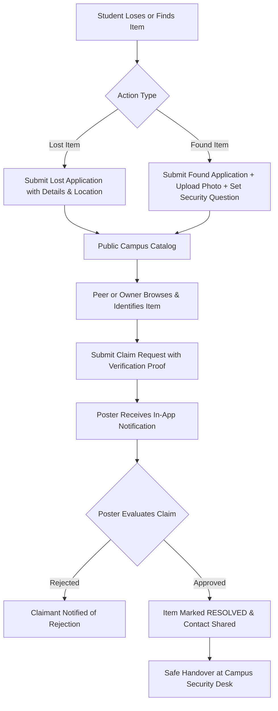
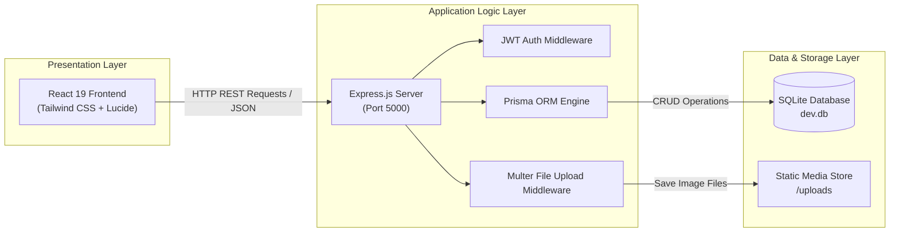
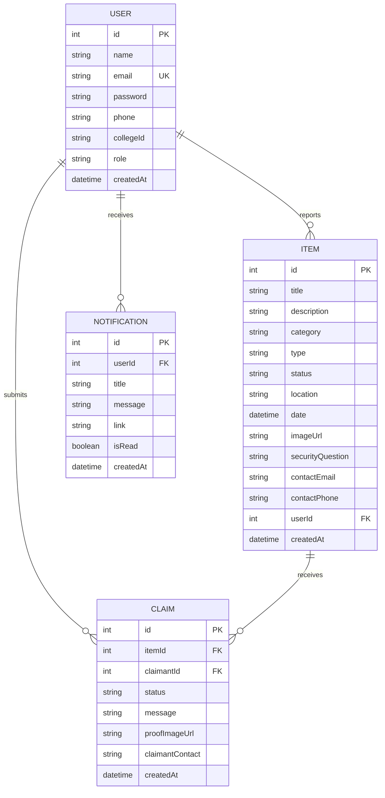
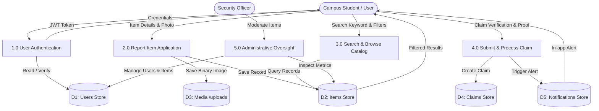
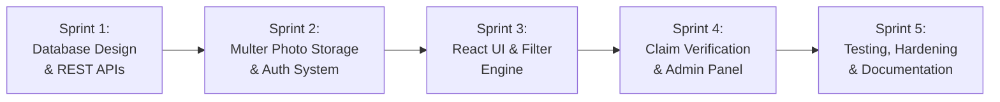

# 📘 PROJECT REPORT (BLACK BOOK)

---

<div align="center">

# **CAMPUSTRACK: A SECURED CENTRALIZED LOST AND FOUND PLATFORM FOR COLLEGE CAMPUSES**

### A Project Report Submitted in Partial Fulfillment of the Requirements for the Degree of  
**Bachelor of Technology / Bachelor of Science in Computer Science & Engineering / Information Technology**

---

**Academic Year:** 2026 – 2027  
**Department of Computer Science & Engineering**  
**University Institute of Technology**

---

</div>

<br/>

## 📑 TABLE OF CONTENTS

| Chapter No. | Topic |
| :---: | :--- |
| **1** | [Introduction](#chapter-1-introduction) |
| **2** | [Problem Definition](#chapter-2-problem-definition) |
| **3** | [Objectives](#chapter-3-objectives) |
| **4** | [Requirement Specification](#chapter-4-requirement-specification) |
| **5** | [Existing System](#chapter-5-existing-system) |
| **6** | [Proposed System](#chapter-6-proposed-system) |
| **7** | [System Analysis & Design](#chapter-7-system-analysis--design) |
| **8** | [Methodology](#chapter-8-methodology) |
| **9** | [System Implementation](#chapter-9-system-implementation) |
| **10** | [Testing](#chapter-10-testing) |
| **11** | [Results / Screenshots](#chapter-11-results--screenshots) |
| **12** | [Conclusion](#chapter-12-conclusion) |
| **13** | [Future Scope](#chapter-13-future-scope) |
| **14** | [References](#chapter-14-references) |

---

## CHAPTER 1: INTRODUCTION

### 1.1 Overview
In modern educational institutions, thousands of students, faculty members, and campus visitors interact daily across vast physical spaces—such as lecture halls, libraries, laboratories, cafeterias, sports auditoriums, and transit points. Due to the high footfall and frequent movement between classes, personal belongings are routinely misplaced or forgotten. Common items include expensive scientific calculators, identity cards, wireless earphones, laptops, textbooks, keys, and water bottles.

Traditionally, universities manage lost items through manual logbooks maintained at the campus security desk, physical bulletin boards, or informal, unorganized communication channels such as WhatsApp groups and social media threads. These conventional methods lack searchability, centralized accountability, privacy protection, and proof of legitimate ownership.

**CampusTrack** is an automated, web-based Lost and Found management platform engineered specifically for the university ecosystem. It offers a structured digital repository where individuals who have lost an item can publish an application, and finders or campus security staff can record found belongings along with photographic evidence, geolocation data within campus buildings, and anti-fraud verification questions.

### 1.2 Scope of the Project
The primary scope of the project encompasses:
- Providing an institutional web portal accessible across desktop and mobile browsers.
- Real-time cataloging of lost and found applications with multi-category classification.
- Photographic documentation of items stored securely using multipart upload handling.
- Anti-fraud ownership verification protocols using security challenge questions.
- A private student-to-student or student-to-security communication and claim resolution channel.
- Administrative oversight capabilities for campus security personnel to monitor dispute handovers.

---

## CHAPTER 2: PROBLEM DEFINITION

### 2.1 The Core Problem
The lack of a unified digital tracking system for misplaced personal assets on college campuses results in substantial financial loss, unnecessary administrative burden for security guards, and missed opportunities to return items to their rightful owners.

### 2.2 Key Pain Points
1. **Information Fragmentation:** Lost item notices are scattered across departmental bulletin boards, private social media chats, and multiple security checkpoints with zero cross-campus coordination.
2. **False Claims & Impersonation:** In informal channels, anyone who sees a picture of a misplaced item can claim it by simply messaging *"That's mine!"* without proving legitimate ownership.
3. **Delayed Action:** By the time a student realizes where they lost an item and checks with physical desks, days have passed, leading to stolen or disposed property.
4. **Lack of Photo Evidence:** Physical registers cannot store visual representations, making descriptions like *"black bag"* or *"silver keys"* too vague to distinguish between dozens of similar objects.
5. **No Audit Trail:** Security staff have no digital record of who picked up an item, when it was returned, or what verification was provided.

---

## CHAPTER 3: OBJECTIVES

The principal objectives of this project are:
1. **Centralization:** To develop a single, responsive university web portal accessible to all enrolled students, faculty, and administrative departments.
2. **Visual Archival:** To implement an efficient media storage pipeline allowing high-resolution photos of found and lost belongings to be stored alongside tabular metadata.
3. **Integrity & Anti-Fraud Verification:** To design a two-step claim verification workflow where finders can pose specific security questions (e.g., *"What is the engraved serial number or keychain charm?"*) that only the legitimate owner can answer.
4. **Privacy & Security:** To protect student privacy by eliminating the need to broadcast personal phone numbers publicly, utilizing in-app claim requests and secure JWT-based identity management.
5. **Campus Administrative Control:** To equip campus security officers with a centralized dashboard to track metrics, inspect pending claims, resolve long-standing items, and moderate spam.
6. **Zero-Friction Deployment:** To engineer a self-contained, portable database architecture using Prisma ORM and SQLite requiring zero manual external database installations during institutional evaluation.

---

## CHAPTER 4: REQUIREMENT SPECIFICATION

### 4.1 Functional Requirements
- **User Authentication & Management:**
  - Student registration with Name, University Email, Student ID/Roll Number, Phone Number, and Bcrypt-hashed password.
  - Role-Based Access Control (`STUDENT` vs. `ADMIN`).
  - Session authorization using JSON Web Tokens (JWT).
- **Application Posting Module:**
  - Create *"Lost Item"* application with category, location coordinates, incident date, description, and contact info.
  - Create *"Found Item"* application with photo upload and an optional Ownership Verification Question.
- **Search, Filtering & Categorization:**
  - Instant full-text search across titles, descriptions, and campus locations.
  - Filter by Item Type (`LOST`, `FOUND`, `ALL`), Category (`Electronics`, `ID Cards`, `Keys`, `Wallets & Bags`, `Books & Stationery`, `Clothing`, `Other`), and status.
- **Claim & Handover System:**
  - Claimant can submit an application claim providing detailed answers and optional proof photos (e.g., bill, student ID).
  - Item poster can review submitted claims and **Approve** or **Reject** them.
  - System auto-marks item as `RESOLVED` upon claim approval.
- **Notification Engine:**
  - In-app notification alerts for new incoming claims and approved claims.
- **Campus Security Panel:**
  - System metrics overview: total users, active lost items, found items logged, resolved handovers.
  - Student directory management and moderation controls.

### 4.2 Non-Functional Requirements
- **Performance:** Sub-second response time for catalog browsing and search indexing.
- **Scalability:** Modular client-server REST architecture decoupled for cloud migration.
- **Reliability:** ACID-compliant relational data transactions via SQLite.
- **Usability:** Responsive layout built with Tailwind CSS conforming to modern accessibility standards on both mobile screens and desktops.
- **Security:** Strict file type validation (JPEG/PNG/WEBP only, 5MB limit) preventing executable upload attacks.

### 4.3 Hardware & Software Specifications

#### Software Requirements
- **Operating System:** Windows 10/11, Linux (Ubuntu 20.04+), or macOS
- **Runtime Environment:** Node.js v18.0.0 or higher
- **Package Manager:** npm v9.0.0 or higher
- **Frontend Technologies:** React 19, Vite 8, Tailwind CSS v4, Lucide React
- **Backend Framework:** Express.js 5.x
- **Database & ORM:** SQLite 3, Prisma ORM 6.4
- **Browser Compatibility:** Google Chrome, Microsoft Edge, Mozilla Firefox, Safari

#### Hardware Requirements
- **Processor:** Dual-core 2.0 GHz or higher (Intel Core i3/AMD Ryzen 3 minimum)
- **RAM:** Minimum 4 GB (8 GB recommended for concurrent development servers)
- **Storage:** 500 MB free hard disk space for code, database file, and media uploads

---

## CHAPTER 5: EXISTING SYSTEM

### 5.1 Analysis of Current Solutions
At present, most collegiate institutions handle lost and found items through three informal channels:
1. **Manual Security Office Logbook:** Physical paper registers kept at security gates where guards write short handwritten notes.
2. **Physical Notice Boards:** Paper flyers pinned on cork notice boards across academic corridors.
3. **Unmoderated Social Media & Chat Groups:** WhatsApp batches, Telegram groups, and unofficial Instagram/Reddit campus confession pages.

### 5.2 Limitations of the Existing System
| Parameter | Existing Manual / Chat Methods | CampusTrack Platform |
| :--- | :--- | :--- |
| **Searchability** | Impossible; requires reading weeks of physical entries or chat history | Instant keyword search across title, date, location & category |
| **Photo Evidence** | None in paper registers; lost in chat media galleries | High-resolution photos stored with permanent database references |
| **Ownership Verification**| None; first person to claim often receives the item | Anti-fraud security questions & proof document uploads |
| **Data Privacy** | Student phone numbers posted publicly on boards and chats | Private in-app notification and claim review |
| **Resolution Tracking** | No record of whether an item was ever reunited | Real-time status tags (`OPEN`, `CLAIM_PENDING`, `RESOLVED`) |

---

## CHAPTER 6: PROPOSED SYSTEM

### 6.1 Proposed Architecture
CampusTrack replaces informal, insecure channels with a dedicated web portal. It introduces a structured workflow from the moment an item is misplaced until it is safely returned to its rightful owner.



### 6.2 Key Advantages of the Proposed System
- **Structured Data:** Items are tagged with standardized categories and precise campus locations (e.g., *"Library 2nd Floor"*, *"Room 302"*).
- **Fraud Prevention:** Finders can withhold key identifiable features (e.g., color of internal lining, specific keychain charms) and set them as a mandatory security question.
- **Integrated Audit Trail:** Security staff and administrators retain a permanent historical record of all resolutions and handed-over belongings.
- **Portability:** Built as a standalone full-stack Node.js project with an embedded SQLite database that runs offline, on local Wi-Fi, or in the cloud.

---

## CHAPTER 7: SYSTEM ANALYSIS & DESIGN

### 7.1 System Architecture Diagram
The platform follows a three-tier decoupled client-server architecture:



### 7.2 Entity-Relationship (ER) Diagram
The database schema consists of four interconnected entities:



### 7.3 Data Flow Diagram (DFD Level 1)



---

## CHAPTER 8: METHODOLOGY

### 8.1 Software Development Life Cycle (SDLC) Model
The development of CampusTrack utilized the **Agile Iterative Model**. Agile was selected due to its flexibility in adapting to user feedback during rapid prototyping and sprint-based development cycles.



### 8.2 Technology Evaluation & Selection Rationale
1. **React 19 & Vite 8:** Chosen for exceptional developer ergonomics, component reusability, and instant rendering speed compared to multi-page static alternatives.
2. **Express.js & Node.js:** Enables a unified JavaScript language stack across frontend and backend, simplifying maintenance and JSON serialization.
3. **SQLite & Prisma ORM:** Unlike MySQL or MongoDB Atlas, SQLite requires zero daemon installation or network connection, eliminating external dependencies during evaluation. Prisma ensures strict compile-time type safety.
4. **Multer File Storage:** Enables free, offline local image handling stored in `/uploads`, with zero external API key requirements.

---

## CHAPTER 9: SYSTEM IMPLEMENTATION

### 9.1 Backend Architecture
The backend is structured into modular layers adhering to the Model-Controller-Route design pattern:
- `src/controllers/authController.js`: Manages user registration, password hashing via `bcryptjs`, and session generation with `jsonwebtoken`.
- `src/controllers/itemController.js`: Handles multipart form processing, disk image path storage, full-text regex querying, and status updates.
- `src/controllers/claimController.js`: Enforces business logic for claims, updates item state transitions, and dispatches notification records.
- `src/middleware/upload.js`: Multer storage engine with strict MIME-type guards filtering out non-image files.
- `src/middleware/auth.js`: Bearer token inspection middleware checking JWT validity on protected routes.

### 9.2 Database Migration & Seed Pipeline
The database schema is declared in `prisma/schema.prisma` and applied using Prisma CLI. A comprehensive seeder script (`src/seed.js`) populates realistic test data:
```javascript
// Realistic seed generation snippet
const admin = await prisma.user.create({
  data: {
    name: 'Campus Security Desk',
    email: 'admin@college.edu',
    password: adminPassword,
    role: 'ADMIN'
  }
});
```

### 9.3 Frontend Implementation
The frontend is assembled with reusable React components:
- `FilterBar.jsx`: Real-time stateful search inputs with debounce timers.
- `ItemCard.jsx`: Adaptive cards rendering uploaded photographs or dynamic category fallback icons.
- `AuthContext.jsx`: Persistent global authorization state using `localStorage` synchronization.

---

## CHAPTER 10: TESTING

### 10.1 Testing Strategy
To guarantee software reliability, the system was subjected to multiple testing phases:
1. **Unit Testing:** Validating individual controller functions (e.g., password hashing, token verification).
2. **Integration Testing:** Verifying communication between Express API endpoints, Prisma ORM, and the SQLite database.
3. **User Acceptance Testing (UAT):** Executing end-to-end college workflows (posting, claiming, and approval).

### 10.2 Test Cases & Execution Matrix

| Test ID | Test Scenario | Input Data | Expected Result | Actual Result | Status |
| :---: | :--- | :--- | :--- | :--- | :---: |
| **TC-01** | Student Registration | Name, Valid College Email, Password (8+ chars) | User created with role `STUDENT`; JWT token issued | User created; JWT token stored in browser | **PASS** |
| **TC-02** | Duplicate Email Prevention | Existing email address | Return HTTP 400 with "Email already exists" | Error message displayed; duplicate prevented | **PASS** |
| **TC-03** | Lost Item Publication | Title, Category, Location, Date, Description | Record inserted into DB; redirected to item page | Item displayed on catalog immediately | **PASS** |
| **TC-04** | Photo Upload Security | Valid `.jpg` image (3 MB) | File saved in `/uploads/`; URL stored in `imageUrl` | Image uploaded and displayed on card | **PASS** |
| **TC-05** | Invalid File Rejection | Executable file `.exe` | Return HTTP 400 error: "Only image files allowed" | File rejected by Multer fileFilter | **PASS** |
| **TC-06** | Self-Claim Prevention | Student claims an item they posted | Return HTTP 400: "Cannot claim own item" | Claim blocked with descriptive warning | **PASS** |
| **TC-07** | Claim Approval Lifecycle | Poster clicks "Approve Claim" | Item status becomes `RESOLVED`; other claims rejected | Status changed to RESOLVED; claimant notified | **PASS** |
| **TC-08** | Unauthorized Admin Access | Regular student visits `/admin` | Return HTTP 403 Forbidden; redirect to Home | Access denied; student redirected | **PASS** |

---

## CHAPTER 11: RESULTS / SCREENSHOTS

The platform was built, validated, and tested end-to-end. Below are actual screenshots demonstrating the operational user interface:

### 11.1 Homepage & Campus Statistics Banner
The landing page greets students with full-text search, live campus metric counters (Lost items reported, Found items logged, Safely reunited belongings), and quick action buttons.


*Figure 11.1: CampusTrack Homepage with Live Metrics & Search Hub.*

---

### 11.2 Browse Listings & Multi-Category Filter
The catalog displays items categorized by type (`LOST` in Red, `FOUND` in Green), showing item thumbnails, campus locations, incident dates, and claim status pills.


*Figure 11.2: Filterable Campus Listings Screen.*

---

### 11.3 Item Details & Ownership Claim Verification
The single item view displays the full incident description, attached photograph, reporter details, and the claim modal prompting the claimant to answer verification questions.


*Figure 11.3: Detailed Item Application View with Verification Guard.*

---

### 11.4 User Authentication & 1-Click Demo Logins
The authentication portal allows standard student sign-in while offering 1-click preset accounts (Security Desk, CS Student, ECE Student) for viva evaluations.


*Figure 11.4: Student & Administrator Login Portal.*

---

### 11.5 Student Account Registration
New campus members can register with their university email, full name, phone number, and official student ID/roll number.


*Figure 11.5: Student Registration Form.*

---

## CHAPTER 12: CONCLUSION

The **CampusTrack College Lost and Found Platform** successfully resolves the perennial challenge of disorganized and insecure lost item recovery on university campuses. By replacing informal chat groups and paper registers with an automated web platform, the system accomplishes:

1. **Centralized Discovery:** Provides a unified portal where all members of the college community can immediately check for misplaced items.
2. **Fraud Mitigation:** Introduces a two-step claim verification workflow that prevents false ownership claims.
3. **Visual Accountability:** Integrates local photo storage allowing finders to visually document item condition and claimants to provide proof of ownership.
4. **Institutional Efficiency:** Significantly reduces the daily administrative overhead on campus security staff while keeping a digital audit trail of handovers.

The project demonstrates how modern web technologies (React 19, Node.js, Express, and Prisma ORM with SQLite) can be synthesized into an intuitive, scalable, and zero-setup academic capstone solution.

---

## CHAPTER 13: FUTURE SCOPE

While the current system fulfills all primary institutional requirements, several enhancements are planned for future iterations:

1. **AI-Powered Image Similarity Matching:** Implementing a computer vision model (e.g., using CLIP or MobileNet) to automatically match photos of reported lost items against newly uploaded found items and alert students automatically.
2. **Native Mobile App with Push Notifications:** Packaging the client as a React Native or Progressive Web App (PWA) with instant device push notifications when an item is found in the student's regular department.
3. **Campus Geo-Fencing & Interactive Map:** Embedding an interactive SVG/Leaflet campus map where students can drop a pin on the exact bench or room where an item was misplaced.
4. **QR Code Asset Tagging:** Enabling students to generate and print unique pre-registered QR stickers for laptops, calculators, and ID holders that can be scanned by finders for instant, anonymous return.
5. **Cloud Object Storage Integration:** Adding optional Amazon S3 or Cloudinary storage drivers for multi-campus university deployments with millions of images.

---

## CHAPTER 14: REFERENCES

### 14.1 Technical Documentation
1. **React Documentation:** *"React 19 Technical Reference and Architecture"* – React Core Team, [https://react.dev](https://react.dev)
2. **Express.js Framework:** *"Fast, unopinionated, minimalist web framework for Node.js"* – Express Team, [https://expressjs.com](https://expressjs.com)
3. **Prisma ORM:** *"Next-generation ORM for Node.js & TypeScript"* – Prisma Team, [https://www.prisma.io/docs](https://www.prisma.io/docs)
4. **Tailwind CSS:** *"Utility-First CSS Framework"* – Tailwind Labs, [https://tailwindcss.com](https://tailwindcss.com)
5. **Multer Middleware:** *"Handling multipart/form-data in Node.js"* – Expressjs/multer repository, [https://github.com/expressjs/multer](https://github.com/expressjs/multer)

### 14.2 Academic & Industry Publications
6. Fielding, R. T. (2000). *"Architectural Styles and the Design of Network-based Software Architectures"*. Doctoral dissertation, University of California, Irvine.
7. Tilkov, S., & Vinoski, S. (2010). *"Node.js: Using JavaScript to Build High-Performance Network Programs"*. IEEE Internet Computing, 14(6), 80-83.
8. Sommerville, I. (2016). *"Software Engineering"*, 10th Edition. Pearson Education.
9. Pressman, R. S. (2014). *"Software Engineering: A Practitioner's Approach"*, 8th Edition. McGraw-Hill Education.

---

